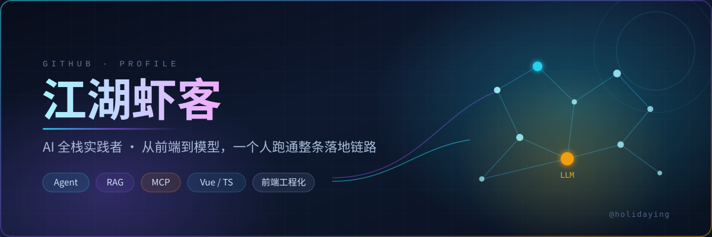

  

<!-- banner.svg 是本仓库 assets/ 下的封面图（自己画的技术风 SVG，无外部依赖）。
     必须把 assets/banner.svg 一起 commit 到仓库里，相对路径才生效；
     封面里已经有大标题了，嫌重复可以把下面这行 <h1> 删掉，只留副标题 -->
<h1 align="center">江湖虾客</h1>

  <b>AI 全栈实践者 🦐 从前端到模型，一个人跑通整条落地链路</b>

  
  
  
  
  

---

## 🚀 代表作

> 自建仓库 51 个，⭐ 合计 73（数据来自 GitHub 公开接口）

| 项目 | 一句话 | 数据 |
| :--- | :--- | :--- |
| [**ui-home**](https://github.com/holidaying/ui-home) | 程序员在 UI 的路上 —— UI 方向的系统性整理 | ⭐ 27 · 🔀 13 |
| [**webpack-demo**](https://github.com/holidaying/webpack-demo) | 有一种学习，码不停蹄 —— webpack 工程化实践 | ⭐ 25 · 🔀 20 |
| [**vue-demo**](https://github.com/holidaying/vue-demo) | 非单页面组件形态的 vue + vue-router + vue-validator | ⭐ 14 · 🔀 4 |
| [**soucemap**](https://github.com/holidaying/soucemap) | 12 种 sourcemap 打包分析 | ⭐ 3 |
| [**ai-blog**](https://github.com/holidaying/ai-blog) | 正在做的 AI 写作 / 编码实验 · TypeScript | 🕐 活跃中 |

---

## 🔭 我在做的事

**AI 应用全栈落地 · 重点在智能体** — 把大模型能力变成能真正上线、有人用的产品。

从模型选型、Prompt 与 Agent 编排、RAG 检索链路，到后端服务、前端交互与部署运维，一个人跑通端到端交付。关注可控性、成本与工程化，不做 demo，只做跑得起来、扛得住真实用户的东西。

### 🤖 AI Agent / 智能体

- **写作 Agent 流水线**：在 [ai-blog](https://github.com/holidaying/ai-blog) 里把 选题 → 检索 → 初稿 → 校对 拆成四个可组合节点，每段单独可重试、可换模型
- **工具调用与编排**：用 Function Calling / MCP 把搜索、数据库、内部接口接进来，让智能体能真的"动手"，而不只是"说话"
- **多 Agent 协作**：规划 / 执行 / 审查角色分工，靠结果聚合收敛分歧，降低单一模型的幻觉与跑偏
- **长任务可靠性**：上下文压缩与分层记忆、状态检查点、失败重试与人工接管边界，把一次性问答拉长成会话型任务
- **评测闭环**：固定 40 条用例回归 Prompt 与工具链改动，避免"改一句话、崩一片场景"

### 📚 RAG 与知识层

- 文档解析、切块策略、向量检索与重排，把私域知识变成可追问的上下文
- 关键词 + 向量混合检索与引用溯源，答案能指回原文出处，不接受"看起来对"
- 目前用在写作场景的资料召回上，单篇成稿前平均召回 6 ~ 8 篇可引用来源

### ⚙️ 工程化与成本

- 模型路由与降级：按任务难度分配模型，把可控性和 token 成本放在一起算
- 缓存、并发、限流与可观测：让延迟、成功率、单次对话成本变成看得见的指标
- AI 前端交互：流式输出、中断与重试、加载态与错误态设计，用界面把模型的不确定性兜住

<!-- ⚠️ 本节带数字的细节（四段流水线、40 条用例、6~8 篇来源）是按「AI 全栈 + 智能体」定位
     模拟的示例，不是从你仓库取证的真实数据。上线前逐条核对：改成真实值，
     没做过的条目整条删掉——主页写上了被访客问出来会很难看 -->

---

## 🛠 技术栈

  

  AI 方向 
  

<!-- skillicons 的图标名必须是它收录的：openai / claude / py / fastapi / nodejs / docker 都实测可用；
     想换成 langchain、redis、postgres、mongodb 也支持，不认识的图标会被静默跳过（整行变短，不会裂图） -->

📈 展开看能力分布

 

| 方向 | 熟练度 | 主要产出 |
| :--- | :--- | :--- |
| 前端工程化 | ⭐⭐⭐⭐ | webpack 实践、Vue 全家桶、多页面打包、sourcemap 分析 |
| UI / 视觉还原 | ⭐⭐⭐⭐ | ui-home 系统整理、组件与样式实践 |
| AI 应用 / Agent | ⭐⭐⭐⭐ | ai-blog 写作 Agent 流水线 · MCP 工具接入 · RAG 资料召回 |
| 后端与部署 | ⭐⭐⭐ | Node / TypeScript 服务、流式接口、Docker 部署与限流 |

<!-- ⚠️ 星级和上面两行的产出是我按你的定位模拟的（ai-blog 确实是 TypeScript 仓库，
     后端那行按前后端一体推断）。按你自己真实水平调整，别给访客留下把柄 -->

---

## 📊 GitHub 统计

  

  

<!-- ghchart 是按真实 commit 记录渲染的贡献热力图（最后一个斜杠后接用户名，
     前面的 1a4fbf 是色号，改成 2ea043 就是 GitHub 官方绿色）；大陆可直连，实测可用 -->

  
    
  

<!-- 说明：github-readme-stats 的 Stats / Top Languages 卡片托管在 vercel.app，
     大陆网络拉不到（实测本机 HTTPS 失败），访客会看到裂图，所以不放；
     想用的话自己 fork 部署到 Vercel 换成自有域名，还能配 Token 显示私有仓库 -->

---

## 📮 找到我

  
  
  

<!-- 公众号名先按展示名"江湖虾客"模拟填上了，真实名字不一样就改这一处；
     如果有公众号文章合集页/知乎，可以在外面套一层 <a href="..."> 变成可点击 -->

<!-- 邮箱徽章：放了就是公开暴露，大概率收垃圾邮件。要放就换成真实地址再取消注释
     （@ 必须写成 %40，否则 shields 解析不了）

-->

  Thanks for visiting · 从 2015 年敲下第一个 commit 到现在

<!-- 可选彩蛋：贡献图小蛇，需要在本仓库加 GitHub Action（仓库 https://github.com/Platane/snk ），
     生成的 github-contribution-grid-snake.svg 放进仓库后再取消下面注释

-->
